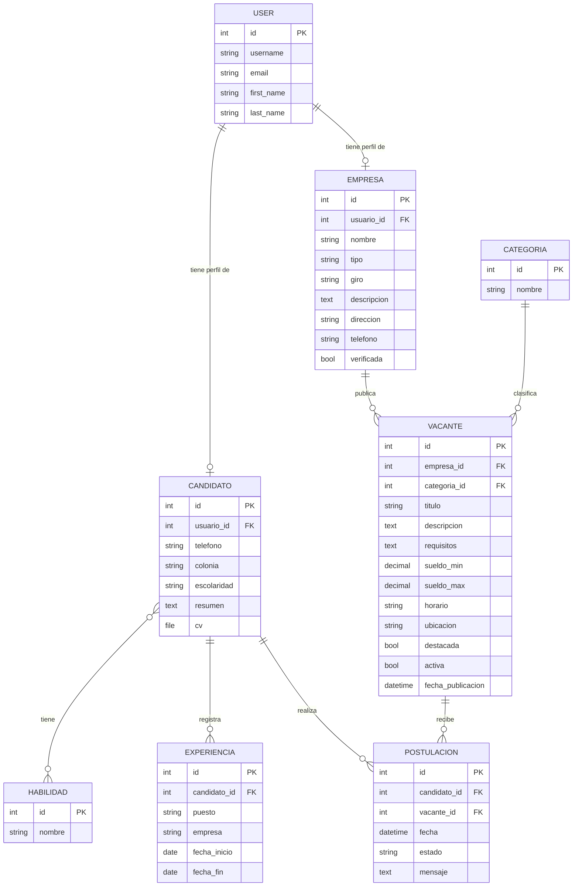

[README.md]
# Bolsa de Empleo Tizayuca

Plataforma web de bolsa de empleo para Tizayuca, Hidalgo y alrededores. Conecta a personas que buscan trabajo con empresas del parque industrial y negocios locales (barberías, panaderías, comercios), con la posibilidad de que el municipio verifique empresas y destaque vacantes.

Proyecto desarrollado con **Django** como parte de la materia en la UTVAM.

## Integrantes del equipo

| Nombre | Matrícula | Usuario de GitHub |
|---|---|---|
| Luis Rodrigo Martínez Hernández | 213110015 | [@RodrigoHdezMtz](https://github.com/RodrigoHdezMtz) |
| Najwa Harue Buenrostro Maldonado | 233110275 | [@HarueMaldonado](https://github.com/HarueMaldonado) |

---

## Estructura del proyecto

El proyecto está dividido en un proyecto principal y cuatro aplicaciones, cada una con una responsabilidad clara:

```
BolsaEmpleoTizayuca/
├── bolsa_empleo/        # Configuración principal (settings, urls)
├── candidatos/          # Perfiles de buscadores de empleo, experiencia y habilidades
├── empresas/            # Empresas y negocios que publican vacantes
├── vacantes/            # Vacantes, categorías y página pública de búsqueda
├── postulaciones/       # Relación entre candidatos y vacantes
├── manage.py
└── requirements.txt
```

| App | Responsabilidad |
|---|---|
| `candidatos` | Perfil del buscador de empleo: datos de contacto, escolaridad, CV, habilidades y experiencia laboral |
| `empresas` | Perfil de la empresa o negocio: tipo (industrial / negocio local), giro, contacto y estado de verificación por el municipio |
| `vacantes` | Ofertas de trabajo con sueldo, horario, requisitos y categoría. Incluye la página de inicio con buscador |
| `postulaciones` | Registro de cada candidato que se postula a una vacante y el seguimiento de su estado |

---

## Documentación de la base de datos

### Diagrama entidad-relación



### Relaciones

| Relación | Tipo | Descripción |
|---|---|---|
| Usuario → Candidato | Uno a uno | Cada cuenta de usuario puede tener un perfil de candidato |
| Usuario → Empresa | Uno a uno | Cada cuenta de usuario puede tener un perfil de empresa |
| Candidato ↔ Habilidad | Muchos a muchos | Un candidato tiene varias habilidades y una habilidad la comparten varios candidatos |
| Candidato → Experiencia | Uno a muchos | Un candidato registra varias experiencias laborales |
| Empresa → Vacante | Uno a muchos | Una empresa publica varias vacantes |
| Categoría → Vacante | Uno a muchos | Cada vacante pertenece a una categoría (ej. Producción, Ventas) |
| Candidato → Postulación | Uno a muchos | Un candidato puede postularse a varias vacantes |
| Vacante → Postulación | Uno a muchos | Una vacante recibe varias postulaciones |

### Detalle de los modelos

#### `candidatos.Candidato`
| Campo | Tipo | Descripción |
|---|---|---|
| `usuario` | OneToOneField(User) | Cuenta de acceso del candidato. Se borra el perfil si se borra el usuario |
| `telefono` | CharField(15) | Teléfono de contacto (opcional) |
| `colonia` | CharField(100) | Colonia donde vive (opcional) |
| `escolaridad` | CharField(100) | Último grado de estudios (opcional) |
| `resumen` | TextField | Descripción breve del perfil (opcional) |
| `cv` | FileField | Currículum en archivo, se guarda en `cv/` (opcional) |
| `habilidades` | ManyToManyField(Habilidad) | Habilidades del candidato |

#### `candidatos.Habilidad`
| Campo | Tipo | Descripción |
|---|---|---|
| `nombre` | CharField(80), único | Nombre de la habilidad (ej. Montacargas, Excel, Atención al cliente) |

#### `candidatos.Experiencia`
| Campo | Tipo | Descripción |
|---|---|---|
| `candidato` | ForeignKey(Candidato) | Candidato al que pertenece |
| `puesto` | CharField(100) | Puesto que ocupó |
| `empresa` | CharField(150) | Empresa donde trabajó |
| `fecha_inicio` | DateField | Fecha de inicio |
| `fecha_fin` | DateField | Fecha de término; vacío si es su trabajo actual |

#### `empresas.Empresa`
| Campo | Tipo | Descripción |
|---|---|---|
| `usuario` | OneToOneField(User) | Cuenta de acceso de la empresa |
| `nombre` | CharField(150) | Nombre comercial |
| `tipo` | CharField(20), opciones | `industrial` o `local` (negocio local) |
| `giro` | CharField(100) | Actividad de la empresa |
| `descripcion` | TextField | Descripción de la empresa (opcional) |
| `direccion` | CharField(200) | Dirección |
| `telefono` | CharField(15) | Teléfono de contacto |
| `verificada` | BooleanField | Lo marca el municipio cuando valida que la empresa es real |

#### `vacantes.Categoria`
| Campo | Tipo | Descripción |
|---|---|---|
| `nombre` | CharField(80), único | Nombre de la categoría |

#### `vacantes.Vacante`
| Campo | Tipo | Descripción |
|---|---|---|
| `empresa` | ForeignKey(Empresa) | Empresa que publica la vacante |
| `categoria` | ForeignKey(Categoria), PROTECT | No se puede borrar una categoría que tenga vacantes |
| `titulo` | CharField(150) | Nombre del puesto |
| `descripcion` | TextField | Descripción del puesto |
| `requisitos` | TextField | Requisitos (opcional) |
| `sueldo_min` / `sueldo_max` | DecimalField | Rango de sueldo (opcional) |
| `horario` | CharField(100) | Horario de trabajo |
| `ubicacion` | CharField(200) | Lugar de trabajo |
| `destacada` | BooleanField | El municipio puede destacar vacantes para que salgan primero |
| `activa` | BooleanField | Solo las vacantes activas se muestran al público |
| `fecha_publicacion` | DateTimeField | Se llena automáticamente al crear la vacante |

#### `postulaciones.Postulacion`
| Campo | Tipo | Descripción |
|---|---|---|
| `candidato` | ForeignKey(Candidato) | Quién se postula |
| `vacante` | ForeignKey(Vacante) | A qué vacante |
| `fecha` | DateTimeField | Se llena automáticamente |
| `estado` | CharField(20), opciones | `enviada`, `vista`, `entrevista`, `aceptada` o `rechazada` |
| `mensaje` | TextField | Mensaje opcional del candidato |

**Restricción:** `postulacion_unica` impide que un mismo candidato se postule dos veces a la misma vacante.

---

## Migraciones

Cada app tiene su migración inicial en su carpeta `migrations/`:

| App | Migración |
|---|---|
| candidatos | `0001_initial.py` |
| empresas | `0001_initial.py` |
| vacantes | `0001_initial.py` |
| postulaciones | `0001_initial.py` |

---

## Cómo correr el proyecto

```bash
# 1. Clonar el repositorio
git clone <URL-del-repositorio>
cd BolsaEmpleoTizayuca

# 2. Crear y activar el ambiente virtual
python3 -m venv MiAmbienteTest
source MiAmbienteTest/bin/activate      # En Windows: MiAmbienteTest\Scripts\activate

# 3. Instalar dependencias
pip install -r requirements.txt

# 4. Aplicar migraciones
python manage.py migrate

# 5. Crear un usuario administrador
python manage.py createsuperuser

# 6. Correr el servidor
python manage.py runserver
```

- Sitio: http://127.0.0.1:8000
- Panel de administración: http://127.0.0.1:8000/admin

---

## Flujo de trabajo en Git

- La rama `main` contiene siempre la versión estable.
- Cada integrante trabaja en su propia rama (por ejemplo `feature/registro-candidatos` o `docs/readme`).
- Los cambios se suben a GitHub y se integran a `main` mediante **Pull Request**, que revisa otro integrante antes de fusionar.
